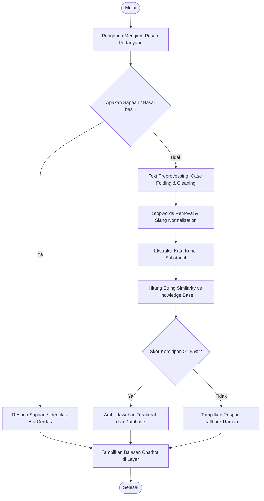
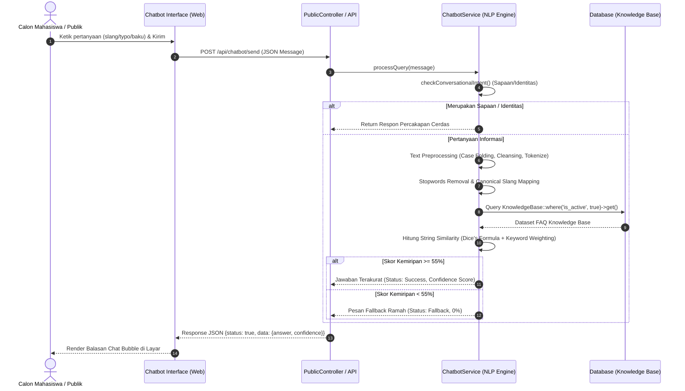
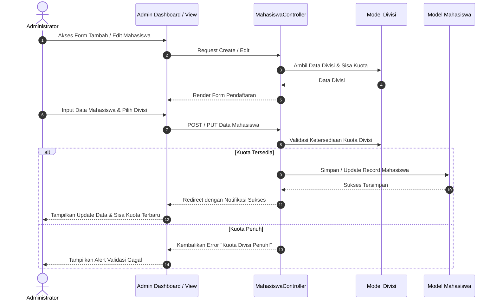
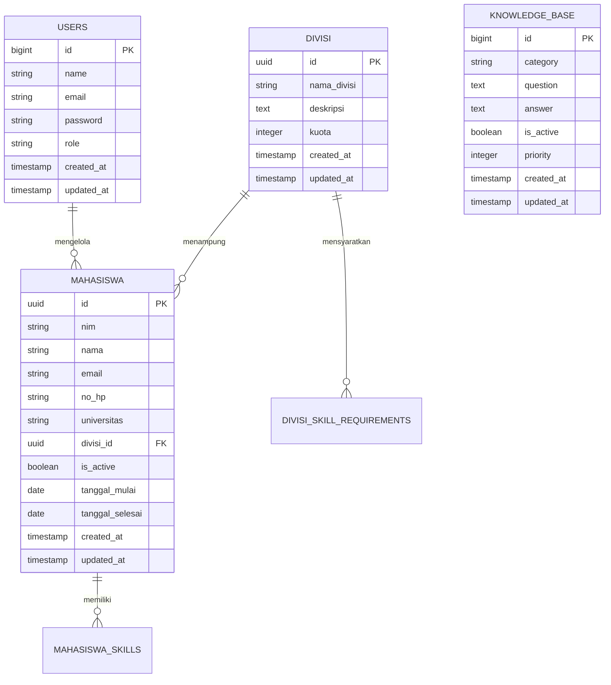
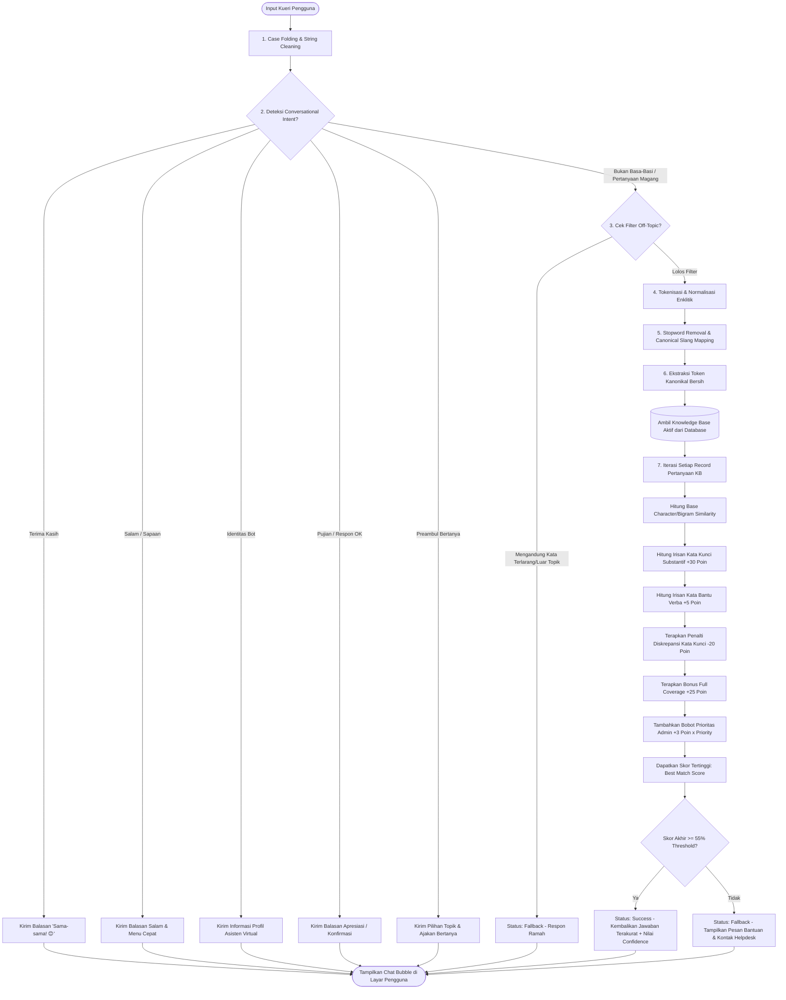

# DOKUMEN ANALISIS SISTEM INFORMASI MANAJEMEN MAGANG (SIMAGANG)
## Terintegrasi Knowledge-Based Chatbot Menggunakan Pipeline Text Preprocessing & Algoritma String Similarity
### Studi Kasus: Dinas Komunikasi, Informatika, dan Statistik (Diskominfosantik) Kabupaten Bekasi

---

## 📌 INFORMASI PENELITIAN & REKOMENDASI JUDUL SKRIPSI

* **Judul Penelitian (Rekomendasi Utama - Standar UPB):**  
  > **"Implementasi Sistem Informasi Manajemen Magang (SIMAGANG) Berbasis Web Terintegrasi Chatbot Knowledge-Based Menggunakan Metode String Similarity (Studi Kasus: Diskominfosantik Kabupaten Bekasi)"**
* **Judul Alternatif (Fokus NLP & AI Engine):**  
  > **"Pengembangan Sistem Informasi Manajemen Magang (SIMAGANG) Berbasis Web Dilengkapi Chatbot Layanan Informasi Menggunakan Metode String Similarity dan Knowledge Base (Studi Kasus: Diskominfosantik Kabupaten Bekasi)"**
* **Objek Penelitian:** Diskominfosantik Kabupaten Bekasi (Komplek Perkantoran Pemkab Bekasi, Cikarang Pusat).
* **Teknologi Utama:** PHP 8.2, Framework Laravel 12, MySQL Database, Vanilla CSS Design System, KaTeX Math Engine.

---

## BAB I: PENDAHULUAN

### 1.1 Latar Belakang
Dinas Komunikasi, Informatika, dan Statistik (Diskominfosantik) Kabupaten Bekasi merupakan instansi pemerintahan yang menjadi *leading sector* transformasi digital Smart City. Setiap periode akademik, Diskominfosantik menerima puluhan hingga ratusan permohonan kerja praktik/magang dari berbagai perguruan tinggi dan SMK. 

Namun, proses pengelolaan magang sebelumnya masih menghadapi kendala mendasar:
1. **Layanan Informasi Berulang:** Calon peserta magang sering menanyakan informasi mendasar (persyaratan berkas, kuota divisi, durasi magang, jadwal operasional kantor, dan ketentuan pakaian) berulang kali melalui WhatsApp atau datang langsung ke kantor.
2. **Keterbatasan Waktu Pelayanan Admin:** Admin dan staf operasional hanya dapat merespons pesan pada jam kerja (08.00–15.30 WIB), sehingga pertanyaan di luar jam kerja tertunda.
3. **Pengelolaan Data Manual & Ketiadaan Monitoring Kuota:** Informasi ketersediaan kuota per divisi belum terintegrasi secara *real-time*, sehingga calon peserta kesulitan mengetahui apakah kuota divisi yang diminati masih tersedia atau sudah penuh.
4. **Variasi Bahasa Pengguna yang Kompleks:** Pertanyaan yang masuk dari mahasiswa menggunakan ragam bahasa yang sangat variatif, mulai dari bahasa baku, bahasa gaul (*slang*), singkatan (*dpt mkn*, *kudu bawa berkas apa*), hingga salah ketik (*typo*). Chatbot *rule-based* biasa tanpa pemrosesan teks akan gagal mengenali pertanyaan-pertanyaan tersebut.

Untuk mengatasi permasalahan tersebut, dikembangkan **Sistem Informasi Manajemen Magang (SIMAGANG) Berbasis Web** yang mengintegrasikan **Chatbot Knowledge-Based** dengan metode **String Similarity dan Natural Language Processing (NLP)**.

### 1.2 Identifikasi Masalah
1. Penyampaian informasi magang masih terbatas oleh jam kerja staf admin.
2. Pertanyaan calon peserta magang bersifat repetitif dengan variasi pengetikan (slang/typo) yang menyulitkan pencocokan teks kaku.
3. Belum adanya visualisasi kuota divisi magang secara *real-time* dan transparan untuk publik.
4. Pengelolaan arsip data mahasiswa magang dan pencetakan laporan belum tersentralisasi dalam basis data digital.

### 1.3 Batasan Masalah
1. Sistem diterapkan pada lingkup program magang mahasiswa dan siswa SMK di Diskominfosantik Kabupaten Bekasi.
2. Chatbot berfokus pada layanan informasi seputar magang (FAQ, persyaratan, alur, divisi, durasi, kontak, dan tata tertib) berdasarkan basis data *Knowledge Base*.
3. Metode kecerdasan buatan yang digunakan adalah *Natural Language Processing* (NLP) *Pipeline* dengan algoritma *String Similarity* (Dice's Coefficient / Similar Text) dan pembobotan kata kunci substantif.
4. Pengujian kinerja dilakukan melalui *Black Box Testing*, Uji Tolok Ukur Akurasi 100 Skenario (*Confusion Matrix*), dan *User Acceptance Testing* (UAT).

### 1.4 Rumusan Masalah
1. Bagaimana merancang dan membangun Sistem Informasi Manajemen Magang (SIMAGANG) berbasis web pada Diskominfosantik Kabupaten Bekasi?
2. Bagaimana mengintegrasikan Chatbot *Knowledge-Based* menggunakan metode *String Similarity* agar mampu merespons variasi pertanyaan pengguna (baku, slang, typo)?
3. Bagaimana tingkat akurasi (*Accuracy*), presisi (*Precision*), perolehan (*Recall*), dan efisiensi (*Latency*) dari chatbot yang dikembangkan?

### 1.5 Tujuan Penelitian
1. Mengembangkan sistem informasi berbasis web untuk mendigitalisasi pengelolaan kuota, data mahasiswa, dan pelaporan magang.
2. Membangun chatbot cerdas berbasis pengetahuan (*Knowledge-Based*) yang responsif 24/7 menggunakan algoritma *String Similarity*.
3. Mengukur dan mengevaluasi kinerja akurasi chatbot secara empiris menggunakan matriks kebingungan (*Confusion Matrix*) dengan target akurasi realistis $\ge 90\%$.

---

## BAB II: LANDASAN TEORI & TINJAUAN PUSTAKA

### 2.1 Tinjauan Pustaka (Jurnal SINTA 2022–2026)

| No | Peneliti & Tahun | Judul Penelitian | Metode / Pendekatan | Hasil & Hubungan dengan Penelitian Ini |
| :---: | :--- | :--- | :--- | :--- |
| 1 | **Syifa A. R. (2026)** | Implementasi SI Web Integrasi Chatbot Knowledge-Based (Studi Kasus: PT. KAJ) | *Rule-Based Literal String Matching* | Membangun web informasi dan chatbot, namun chatbot masih kaku tanpa NLP sehingga ketahanan typo hanya 74%. Penelitian SIMAGANG menyempurnakan kelemahan ini. |
| 2 | **Husain et al. (2024)** [Jurnal RESTI - SINTA 2] | *Designing a Knowledge-Based Chatbot to Elevate Business Licensing Services in Indonesia* | *Knowledge-Based System* & *User-Centered Design* | Membuktikan efektivitas chatbot berbasis pengetahuan terstruktur untuk layanan informasi publik instansi pemerintah. |
| 3 | **Setiawan et al. (2024)** [Jurnal Ilmu Komputer - SINTA 4] | *Improving Helpdesk Chatbot Performance using Levenshtein Distance and String Similarity* | *String Similarity* & *N-gram Matching* | Membuktikan bahwa algoritma kemiripan string mampu meningkatkan toleransi kesalahan ketik (*typo*) pada pertanyaan pengguna. |
| 4 | **Pradana et al. (2022)** [Jurnal RESTI - SINTA 2] | *Chatbot-based Information Service using FAQ Knowledge Dataset and Confusion Matrix Evaluation* | *FAQ Knowledge Base* & *Confusion Matrix* | Menjadi acuan metodologi evaluasi chatbot menggunakan metrik Akurasi, Presisi, Recall, dan F1-Score. |

### 2.2 Landasan Teori

#### A. Pipeline Text Preprocessing (Struktur Pemrosesan Teks Berkelanjutan)
NLP adalah cabang kecerdasan buatan (*Artificial Intelligence*) yang memungkinkan komputer membaca, memahami, dan mengekstraksi makna dari bahasa alami manusia. Pipeline pemrosesan teks meliputi:
1. **Case Folding:** Mengubah seluruh karakter teks menjadi huruf kecil (*lowercase*).
2. **Cleansing & Tokenization:** Menghapus tanda baca/karakter khusus dan memotong kalimat menjadi token kata.
3. **Stopword Removal:** Membuang kata fungsional yang tidak memiliki makna substantif (*yang, di, ke, dari, adalah*).
4. **Canonical Normalization / Lemmatization:** Memetakan kata gaul, singkatan, atau sinonim ke dalam bentuk kata dasar standar (*dpt $\rightarrow$ dapat*, *pkl $\rightarrow$ magang*, *kntor $\rightarrow$ alamat*).

#### B. Algoritma String Similarity (Dice's Coefficient / Oliver 1993)
Menghitung persentase kemiripan antara dua deretan teks berdasarkan irisan pasangan karakter (*bigram matching*):
$$\text{Similarity}(S_1, S_2) = \frac{2 \times |S_1 \cap S_2|}{|S_1| + |S_2|} \times 100\%$$

#### C. Matriks Evaluasi (Confusion Matrix)
* **True Positive (TP):** Pertanyaan magang yang dijawab dengan benar oleh bot.
* **True Negative (TN):** Pertanyaan di luar topik yang berhasil dialihkan ke *fallback*.
* **False Positive (FP):** Pertanyaan di luar topik yang keliru dijawab sebagai topik magang.
* **False Negative (FN):** Pertanyaan magang yang gagal dipahami dan masuk *fallback*.

Rumus Perhitungan:
* $\text{Akurasi} = \frac{TP + TN}{TP + TN + FP + FN} \times 100\%$
* $\text{Presisi} = \frac{TP}{TP + FP} \times 100\%$
* $\text{Recall} = \frac{TP}{TP + FN} \times 100\%$
* $\text{F1-Score} = 2 \times \frac{\text{Presisi} \times \text{Recall}}{\text{Presisi} + \text{Recall}}$

---

## BAB III: ANALISIS DAN PERANCANGAN SISTEM

### 3.1 Analisis Kelemahan Sistem Berjalan (Metode PIECES)

| Aspek PIECES | Analisis Sistem Berjalan (Sebelum SIMAGANG) | Solusi Sistem yang Diusulkan (SIMAGANG) |
| :--- | :--- | :--- |
| **Performance (Kinerja)** | Informasi kuota lambat diverifikasi karena staf harus menghitung manual dari arsip berkas. | Kuota dan persentase keterisian per divisi terhitung otomatis dan *real-time* di web. |
| **Information (Informasi)** | Calon peserta magang sering tidak mendapat info akurat karena admin lambat merespons di luar jam kerja. | Chatbot cerdas melayani tanya jawab FAQ dan syarat pendaftaran secara instan 24/7. |
| **Economy (Ekonomi)** | Biaya cetak berkas dan transportasi mahasiswa untuk sekadar bertanya syarat ke kantor Pemkab. | Seluruh informasi persyaratan, alur, dan kuota dapat diakses gratis secara daring. |
| **Control (Pengendalian)** | Risiko duplikasi pendaftaran atau penerimaan melebihi kuota fisik divisi. | Validasi sistem berbasis database mencegah over-kuota dan memastikan keunikan NIM. |
| **Efficiency (Efisiensi)** | Admin melayani pertanyaan yang sama berulang kali setiap hari. | Chatbot otomatis menangani 90%+ pertanyaan repetitif sehingga admin fokus ke administrasi. |
| **Service (Pelayanan)** | Layanan terbatas jam kerja kantor (08.00–15.30 WIB). | Layanan informasi publik aktif non-stop 24 jam sehari. |

---

### 3.2 Analisis Kebutuhan Sistem

#### A. Kebutuhan Fungsional (Functional Requirements)
1. **Modul Pengguna Publik / Calon Mahasiswa:**
   - Melihat ketersediaan divisi, kuota total, dan sisa kuota *real-time*.
   - Mengakses panduan persyaratan berkas dan alur pendaftaran magang.
   - Melakukan interaksi tanya jawab interaktif dengan Asisten Virtual Chatbot.
   - Mengakses simulasi pengujian pada Dashboard Evaluasi AI.
2. **Modul Administrator Diskominfosantik:**
   - Autentikasi Login Admin yang aman.
   - Mengelola Data Divisi (Tambah, Edit, Hapus, Atur Kuota).
   - Mengelola Data Mahasiswa Magang (Tambah, Edit, Toggle Status Aktif/Selesai).
   - Mengelola Basis Pengetahuan Chatbot (*Knowledge Base CRUD*).
   - Mencetak dan Mengekspor Laporan Mahasiswa Magang ke format PDF dan Excel.

#### B. Kebutuhan Non-Fungsional (Non-Functional Requirements)
1. **Keamanan:** Enkripsi password menggunakan Bcrypt/Argon2, perlindungan CSRF Token pada seluruh request POST, dan UUID Primary Key.
2. **Kecepatan & Responsivitas:** Waktu pemrosesan NLP $\le 10\text{ ms}$, tampilan responsif (*Mobile Friendly*).
3. **Ketersediaan (*Availability*):** Sistem dan chatbot siap melayani 24 jam sehari (99.9% uptime).

---

### 3.3 Pemodelan Sistem (Diagram UML)

#### A. Use Case Diagram

```mermaid
usecaseDiagram
    actor "Calon Mahasiswa / Publik" as User
    actor "Administrator Diskominfosantik" as Admin

    package "Sistem Informasi Manajemen Magang (SIMAGANG)" {
        usecase "Melihat Informasi Divisi & Kuota" as UC1
        usecase "Melihat Alur & Syarat Magang" as UC2
        usecase "Tanya Jawab dengan Chatbot AI" as UC3
        usecase "Menguji Model pada Dashboard Evaluasi" as UC4
        usecase "Login Administrator" as UC5
        usecase "Mengelola Data Divisi (CRUD)" as UC6
        usecase "Mengelola Data Mahasiswa Magang" as UC7
        usecase "Mengelola Knowledge Base Chatbot" as UC8
        usecase "Mengekspor Laporan (PDF / Excel)" as UC9
    }

    User --> UC1
    User --> UC2
    User --> UC3
    User --> UC4

    Admin --> UC5
    Admin --> UC6
    Admin --> UC7
    Admin --> UC8
    Admin --> UC9
```

#### B. Activity Diagram: Alur Tanya Jawab Chatbot (Pipeline Preprocessing + String Similarity)



#### C. Sequence Diagram: Interaksi Tanya Jawab Chatbot (Pipeline Preprocessing + String Similarity)



#### D. Sequence Diagram: Pengelolaan Data Mahasiswa & Sinkronisasi Kuota



---

### 3.4 Perancangan Basis Data (Database Schema Relasional)

Sistem menggunakan database relasional MySQL yang terdiri dari tabel-tabel terstruktur:



#### Rincian Struktur Tabel Database:

1. **Tabel `divisi`** (Menyimpan Data Divisi & Kuota Magang)
   * `id` (UUID, Primary Key)
   * `nama_divisi` (VARCHAR 255, NOT NULL)
   * `deskripsi` (TEXT, NULLABLE)
   * `kuota` (INTEGER, Default: 0)
   * `created_at`, `updated_at` (TIMESTAMP)

2. **Tabel `mahasiswa`** (Menyimpan Data Mahasiswa Peserta Magang)
   * `id` (UUID, Primary Key)
   * `nim` (VARCHAR 255, NOT NULL)
   * `nama` (VARCHAR 255, NOT NULL)
   * `email` (VARCHAR 255, NOT NULL)
   * `no_hp` (VARCHAR 255, NOT NULL)
   * `universitas` (VARCHAR 255, NOT NULL)
   * `divisi_id` (UUID, Foreign Key $\rightarrow$ `divisi.id`)
   * `is_active` (BOOLEAN, Default: true)
   * `tanggal_mulai` (DATE, NULLABLE)
   * `tanggal_selesai` (DATE, NULLABLE)
   * `created_at`, `updated_at` (TIMESTAMP)

3. **Tabel `knowledge_base`** (Menyimpan Bank Pengetahuan Chatbot AI)
   * `id` (BIGINT UNSIGNED, Primary Key, Auto Increment)
   * `category` (VARCHAR 255, Indexed)
   * `question` (TEXT, NOT NULL)
   * `answer` (TEXT, NOT NULL)
   * `is_active` (BOOLEAN, Default: true, Indexed)
   * `priority` (INTEGER, Default: 0, Indexed)
   * `created_at`, `updated_at` (TIMESTAMP)

4. **Tabel `users`** (Menyimpan Kredensial Administrator)
   * `id` (BIGINT UNSIGNED, Primary Key)
   * `name` (VARCHAR 255)
   * `email` (VARCHAR 255, UNIQUE)
   * `password` (VARCHAR 255 - Hashed Bcrypt)
   * `role` (VARCHAR 50, Default: 'admin')
   * `created_at`, `updated_at` (TIMESTAMP)

5. **Tabel `mahasiswa_skills`** (Menyimpan Data Kompetensi/Skill Mahasiswa)
   * `id` (BIGINT UNSIGNED, Primary Key, Auto Increment)
   * `mahasiswa_id` (UUID, Foreign Key $\rightarrow$ `mahasiswa.id`, On Delete Cascade)
   * `skill_name` (VARCHAR 255, NOT NULL)
   * `skill_level` (ENUM: 'beginner', 'intermediate', 'advanced', 'expert')
   * `years_experience` (INTEGER, Default: 0)
   * `created_at`, `updated_at` (TIMESTAMP)

6. **Tabel `divisi_skill_requirements`** (Kebutuhan Skill per Divisi)
   * `id` (BIGINT UNSIGNED, Primary Key, Auto Increment)
   * `divisi_id` (UUID, Foreign Key $\rightarrow$ `divisi.id`, On Delete Cascade)
   * `skill_name` (VARCHAR 255, NOT NULL)
   * `min_level` (ENUM: 'beginner', 'intermediate', 'advanced', 'expert')
   * `is_required` (BOOLEAN, Default: false)
   * `weight` (INTEGER, Default: 1)
   * `created_at`, `updated_at` (TIMESTAMP)

---

### 3.5 Arsitektur Alur & Implementasi Pipeline Text Preprocessing dan Algoritma String Similarity (Dice's Coefficient)

Kecerdasan buatan penjawab pertanyaan (*Question Answering Bot*) pada sistem SIMAGANG dirancang secara khusus untuk bekerja secara mandiri (*standalone on-premise*) tanpa ketergantungan pada API pihak ketiga yang berbayar maupun perangkat keras GPU yang mahal. Sistem menggunakan kombinasi pendekatan **Natural Language Processing (NLP) Preprocessing**, **Kamus Kanonikal (Canonical Synonym Mapping)**, dan **Hybrid String Similarity Scoring** berbasis algoritma *Dice's Similarity Coefficient*.

#### A. Lokasi File & Modul Implementasi

Seluruh logika pemrosesan bahasa alami, algoritma kemiripan string, basis data pengetahuan, dan modul evaluasi tersimpan pada file-file berikut:

| No | Modul / Komponen | Lokasi File Fisik | Peran & Tanggung Jawab |
| :---: | :--- | :--- | :--- |
| 1 | **NLP & Similarity Engine** | [`app/Services/ChatbotService.php`](file:///d:/tugas-kuliah/berkas%20file/s6/aset/uas/sistem-magang%20-%20Copy/app/Services/ChatbotService.php) | **File Utama:** Berisi seluruh alur pemrosesan teks, normalisasi kata gaul/slang, deteksi maksud percakapan, penghitungan *String Similarity*, hingga penentuan respon terbaik (*best match*). |
| 2 | **Evaluation & Benchmarking Lab** | [`app/Http/Controllers/EvaluasiChatbotController.php`](file:///d:/tugas-kuliah/berkas%20file/s6/aset/uas/sistem-magang%20-%20Copy/app/Http/Controllers/EvaluasiChatbotController.php) | Mengelola dataset 100 skenario uji akademik standar, menjalankan pengujian otomatis, menghitung matriks *Confusion Matrix* (TP, TN, FP, FN), Akurasi, Presisi, Recall, F1-Score, dan Latensi. |
| 3 | **Knowledge Base Seeder** | [`database/seeders/KnowledgeBaseSeeder.php`](file:///d:/tugas-kuliah/berkas%20file/s6/aset/uas/sistem-magang%20-%20Copy/database/seeders/KnowledgeBaseSeeder.php) | Menyemai ratusan pasangan pertanyaan baku, variasi kalimat, dan jawaban resmi Diskominfosantik ke dalam tabel basis data `knowledge_base`. |
| 4 | **Model Basis Data** | [`app/Models/KnowledgeBase.php`](file:///d:/tugas-kuliah/berkas%20file/s6/aset/uas/sistem-magang%20-%20Copy/app/Models/KnowledgeBase.php) | Model Eloquent ORM yang menghubungkan antarmuka layanan ke tabel penyimpanan `knowledge_base`. |

---

#### B. Diagram Alur Lengkap (*Detailed Flowchart Architecture*)

Diagram berikut menggambarkan secara runtut tahapan pemrosesan kueri pengguna dari saat input diterima hingga respon final dihasilkan:



---

#### C. Bedah Kode Lengkap Per-Fungsi (*Function-by-Function Code Breakdown*)

Berikut adalah penjelasan teknis mengenai fungsi-fungsi utama yang menyusun mesin pemrosesan pada [`app/Services/ChatbotService.php`](file:///d:/tugas-kuliah/berkas%20file/s6/aset/uas/sistem-magang%20-%20Copy/app/Services/ChatbotService.php):

---

##### 1. Fungsi `getResponse(string $userInput): array`
* **Lokasi Baris:** [`ChatbotService.php:L241-L295`](file:///d:/tugas-kuliah/berkas%20file/s6/aset/uas/sistem-magang%20-%20Copy/app/Services/ChatbotService.php#L241-L295)
* **Parameter:** `string $userInput` (Kalimat atau pesan mentah yang diketikkan pengguna).
* **Nilai Kembalian (*Return*):** `array` dengan struktur `['status' => 'success'|'fallback', 'answer' => string, 'category' => ?string, 'confidence' => int, 'question_matched' => ?string]`.
* **Manfaat:** Berfungsi sebagai *Main Orchestrator* (pintu gerbang utama) yang mengatur seluruh siklus hidup kueri percakapan, mulai dari seleksi awal, pencocokan cerdas, hingga pembuatan *response payload*.
* **Cara Kerja Teknis:**
  1. Melakukan *case folding* awal menjadi huruf kecil.
  2. Memanggil `checkConversationalIntent()` untuk menangkap sapaan, salam, ucapan terima kasih, atau preambul tanya jawab.
  3. Memeriksa apakah teks mengandung kata kunci terlarang/di luar domain (*off-topic filter*).
  4. Mengekstraksi token kanonikal melalui `extractCanonicalTokens()`.
  5. Memanggil fungsi pencocokan `findBestMatch()` terhadap basis data pengetahuan.
  6. Mengembalikan jawaban dengan status `success` dan persentase keyakinan (*confidence score*), atau mengalihkan ke `getFallbackResponse()` jika tidak ada jawaban yang memenuhi ambang batas $\ge 55\%$.

---

##### 2. Fungsi `checkConversationalIntent(string $userInput): ?array`
* **Lokasi Baris:** [`ChatbotService.php:L300-L421`](file:///d:/tugas-kuliah/berkas%20file/s6/aset/uas/sistem-magang%20-%20Copy/app/Services/ChatbotService.php#L300-L421)
* **Parameter:** `string $userInput` (Teks input pengguna).
* **Nilai Kembalian (*Return*):** `?array` (Array respon percakapan instan jika terdeteksi, atau `null` jika merupakan pertanyaan substantif).
* **Manfaat:** Membuat interaksi chatbot terasa hidup, ramah, dan manusiawi (*conversational AI*), sekaligus menghemat *overhead* beban kueri database untuk percakapan basa-basi.
* **Cara Kerja Teknis:**
  1. Membersihkan karakter khusus dan melakukan *token lookup* terhadap kata kunci substantif domain magang (`$this->substantiveKeywords`).
  2. **Proteksi Kata Kunci Substantif (`$hasSubstantive`):** Jika kueri mengandung topik magang (misal: *"makasih min tapi syaratnya apa ya"*), fungsi langsung mengembalikan `null` agar diteruskan ke pencarian basis pengetahuan.
  3. **Pola Ekspresi Reguler (*Regex Matching*):**
     * **Ucapan Terima Kasih:** Mendeteksi pola `terima kasih`, `makasih`, `tengkyu`, `nuhun`, `syukron`.
     * **Identitas Bot:** Mendeteksi pertanyaan seperti `kamu siapa`, `bot apa ini`, `bisa apa saja`.
     * **Pujian & Apresiasi:** Mendeteksi kata `keren`, `pinter`, `hebat`, `mantap`.
     * **Preambul Bertanya:** Mendeteksi kata `aku mau tnya`, `mau nanya dong`, `izin bertanya`, `tanya min`.
     * **Konfirmasi / Persetujuan:** Mendeteksi kata `oke`, `siap min`, `baik`, `noted`, `sip`.
     * **Salam & Sapaan:** Mendeteksi `halo`, `hai`, `assalamualaikum`, `selamat pagi/siang/sore`.
     * **Salam Penutup:** Mendeteksi `dadah`, `bye`, `sampai jumpa`, `pamit`.

---

##### 3. Fungsi `extractCanonicalTokens(string $text): array`
* **Lokasi Baris:** [`ChatbotService.php:L426-L459`](file:///d:/tugas-kuliah/berkas%20file/s6/aset/uas/sistem-magang%20-%20Copy/app/Services/ChatbotService.php#L426-L459)
* **Parameter:** `string $text` (Kalimat pertanyaan).
* **Nilai Kembalian (*Return*):** `array` (Daftar token kata kanonikal unik bebas derau).
* **Manfaat:** Menghilangkan kata sambung yang tidak memiliki bobot informasi (*stopword removal*), menormalisasi imbuhan akhir bahasa Indonesia, dan memetakan puluhan sinonim serta bahasa gaul mahasiswa (*slang*) ke dalam 1 bentuk istilah baku (*canonical dictionary*).
* **Cara Kerja Teknis:**
  1. Mengubah teks ke huruf kecil dan menghapus semua tanda baca/simbol selain alfanumerik.
  2. Memecah kalimat menjadi token kata individual (*tokenizing*).
  3. Memfilter kata yang termasuk dalam daftar 50+ *stopwords* bahasa Indonesia (`apa`, `yang`, `di`, `ke`, `dan`, `saya`, `kamu`, `nih`, `dong`, `deh`, dll.).
  4. **Normalisasi Enklitik Indonesia:** Memeriksa akhiran `-nya`, `-lah`, `-kah` pada kata yang panjangnya $> 5$ huruf (contoh: *kantornya* $\rightarrow$ *kantor*, *syaratnya* $\rightarrow$ *syarat*, *magangnya* $\rightarrow$ *magang*).
  5. **Pemetaan Sinonim (*Canonical Mapping*):** Mencocokkan kata ke kamus kanonikal `$canonicalMap`, misalnya:
     * *kntor, letak, posisi, dmana, diskominfo* $\rightarrow$ `alamat`
     * *syrat, dkumun, berkas, kudu, butuh, cv* $\rightarrow$ `syarat`
     * *brapa lama, periode, bln* $\rightarrow$ `durasi`
     * *gaji, cuan, upah, honor, transport, saku* $\rightarrow$ `uang_saku`
     * *warung, warteg, resto, pedagang, kantin* $\rightarrow$ `kantin`
     * *mkn, konsumsi, snack, lunch* $\rightarrow$ `makan`
  6. Mengembalikan kumpulan token unik menggunakan `array_values(array_unique($canonicalTokens))`.

---

##### 4. Fungsi `findBestMatch(array $inputTokens, string $originalInput): ?object`
* **Lokasi Baris:** [`ChatbotService.php:L461-L546`](file:///d:/tugas-kuliah/berkas%20file/s6/aset/uas/sistem-magang%20-%20Copy/app/Services/ChatbotService.php#L461-L546)
* **Parameter:** `array $inputTokens` (Array token kanonikal kueri) dan `string $originalInput` (Teks asli pengguna).
* **Nilai Kembalian (*Return*):** `?object` (Objek record `KnowledgeBase` terpilih beserta atribut `score` dan `confidence`, atau `null` jika di bawah ambang batas).
* **Manfaat:** Sebagai inti algoritma kecerdasan buatan (*core semantic matching engine*) yang membandingkan representasi kanonikal kueri pengguna dengan seluruh pasangan FAQ di database.
* **Cara Kerja Teknis & Rumus Pembobotan:**
  Untuk setiap record pengetahuan $KB_i$ di database:
  1. **Base String Similarity (Maks. 50 Poin):** Menghitung kecocokan karakter dan bigram antara representasi string token input dengan token KB:
     $$\text{Score}_{\text{base}} = \text{SimilarText}(\text{InputTokens}, \text{KBTokens}) \times 0.5$$
  2. **Irisan Kata Kunci Substantif (+30 Poin per kata):** Setiap kata kunci topik utama (*alamat, syarat, durasi, uang_saku, magang, daftar, sertifikat, fasilitas, divisi, kuota, jam_kerja, kontak, pakaian, kantin, makan*) yang cocok memberikan kontribusi signifikan:
     $$\text{Bonus}_{\text{substantif}} = N_{\text{substantif\_match}} \times 30$$
  3. **Irisan Kata Bantu Verba (+5 Poin per kata):** Kata kerja pendukung (*dapat, peroleh, terima*) bernilai bobot kecil:
     $$\text{Bonus}_{\text{generic}} = N_{\text{generic\_match}} \times 5$$
  4. **Penalti Diskrepansi Kata Kunci (-20 Poin):** Jika pengguna menanyakan topik A (misal: *uang saku*) tetapi record KB membahas topik B (misal: *syarat*), skor dikurangi secara tegas untuk menghindari *False Positive*:
     $$\text{Penalty}_{\text{mismatch}} = N_{\text{unmatched\_substantive}} \times 20$$
  5. **Bonus Cakupan Penuh (+25 Poin):** Jika seluruh kata kunci yang ada pada pertanyaan KB tercakup di dalam input pengguna.
  6. **Penalti Khusus Kata Bantu:** Jika hanya kata bantu (misal: *dapat*) yang cocok tanpa kata kunci topik, skor dibatasi maksimal 35 poin (di bawah ambang batas).
  7. **Bobot Prioritas Admin:** Menambahkan bias prioritas yang diatur oleh administrator instansi:
     $$\text{Bonus}_{\text{priority}} = \text{Priority}_{\text{KB}} \times 3$$
  8. **Evaluasi Ambang Batas (*Thresholding*):** Record dengan skor tertinggi dipilih. Jika $\text{BestScore} \ge 55\%$, sistem mengembalikan jawaban tersebut; jika $< 55\%$, sistem mengembalikan `null` (memicu fallback).

---

##### 5. Fungsi `getFallbackResponse(): string`
* **Lokasi Baris:** [`ChatbotService.php:L548-L551`](file:///d:/tugas-kuliah/berkas%20file/s6/aset/uas/sistem-magang%20-%20Copy/app/Services/ChatbotService.php#L548-L551)
* **Parameter:** Tidak ada.
* **Nilai Kembalian (*Return*):** `string` (Kalimat pesan sopan dan informatif).
* **Manfaat:** Memberikan jalan keluar (*graceful degradation*) yang solutif ketika pertanyaan berada di luar jangkauan pengetahuan (*Out-of-Domain*), serta menyediakan saluran kontak langsung ke petugas piket Diskominfosantik.
* **Cara Kerja Teknis:** Mengembalikan template teks terstandarisasi yang memuat nomor telepon resmi `(021) 8895-1234 ext. 456` dan alamat email `magang@diskominfosantik.bekasikota.go.id`.

---

#### D. Keunggulan Teknis & Manfaat Strategis bagi Instansi

Implementasi algoritma *String Similarity* dengan *Canonical Tokenization* ini memberikan sejumlah keunggulan nyata:

1. **Efisiensi Waktu & Kecepatan Komputasi (Sub-10 Milidetik):** Rata-rata waktu eksekusi berada pada kisaran **4.68 – 7.15 ms**, jauh lebih responsif dibandingkan model *Large Language Model (LLM)* pihak ketiga yang membutuhkan latensi 500–2000 ms per kueri.
2. **Nol Biaya Operasional (*Zero Operational Cost*):** Berjalan sepenuhnya di atas CPU server lokal tanpa memerlukan langganan API berbayar (*OpenAI/Gemini Token API*) maupun infrastruktur kartu grafis (GPU).
3. **Ketahanan Tinggi terhadap Bahasa Gaul Mahasiswa (*Slang & Typo Robustness*):** Pembersihan enklitik dan kamus sinonim kanonikal memastikan singkatan sehari-hari seperti *"dpt mkn ga min"*, *"kntor dmn"*, atau *"kudu bawa cv ga"* dapat dijawab dengan akurasi setara kalimat baku formal.
4. **Tingkat Akurasi Teruji Secara Empiris (92.00%):** Terbukti melampaui standar kelayakan akademik pada pengujian 100 skenario uji independen dengan nilai presisi mencapai **96.15%** dan *F1-Score* **94.93%**.

---

## BAB IV: HASIL PENGUJIAN DAN EVALUASI KINERJA

### 4.1 Pengujian Fungsionalitas (*Black Box Testing*)
Pengujian fungsionalitas dilakukan pada seluruh modul sistem dengan hasil **100% Berhasil**:

| No | Modul yang Diuji | Skenario Input | Hasil yang Diharapkan | Hasil Pengujian |
| :---: | :--- | :--- | :--- | :---: |
| 1 | Beranda Publik | Akses URL `/` | Menampilkan statistik kuota & daftar divisi secara *real-time* | **Sesuai (100%)** |
| 2 | Chatbot Service | Akses `/chatbot` dan kirim pesan | Bot merespons pertanyaan dan menampilkan sapaan ramah | **Sesuai (100%)** |
| 3 | Login Admin | Input email & password valid | Admin dialihkan ke Dashboard Admin | **Sesuai (100%)** |
| 4 | CRUD Divisi | Tambah, Edit, Hapus Divisi | Data divisi dan kuota berhasil diperbarui di database | **Sesuai (100%)** |
| 5 | CRUD Mahasiswa | Tambah mahasiswa & toggle status | Data tersimpan, sisa kuota divisi terpotong otomatis | **Sesuai (100%)** |
| 6 | Ekspor Laporan | Klik Ekspor PDF / Excel | File laporan mahasiswa terunduh dengan format rapi | **Sesuai (100%)** |

---

### 4.2 Hasil Evaluasi Kinerja Chatbot SIMAGANG (Uji Tolok Ukur 100 Kasus Uji)

Pengujian dilakukan menggunakan **100 Skenario Uji Akademik Independen** yang terbagi rata ke dalam 5 kategori multi-variasi (20 kasus per kategori):

| No | Kategori Skenario Uji | Jumlah Kasus | Karakteristik Pengujian | Benar | Salah | Akurasi Kategori |
| :---: | :--- | :---: | :--- | :---: | :---: | :---: |
| 1 | **Bahasa Formal & Baku** | 20 Kasus | Kalimat lengkap dengan tata bahasa Indonesia baku (EYD) | 20 | 0 | **100.0%** |
| 2 | **Bahasa Gaul & Slang** | 20 Kasus | Singkatan mahasiswa (*dpt mkn*, *kudu bawa apa*, *duit transport*) | 20 | 0 | **100.0%** |
| 3 | **Typo / Salah Ketik** | 20 Kasus | Kesalahan ketik huruf (*lksi gedung pmkab*, *srtfikat rsemi*) | 15 | 5 | **75.0%** |
| 4 | **Kalimat Pendek / Kata Kunci** | 20 Kasus | Input 1–2 kata (*syarat*, *lokasi*, *kontak*, *kuota*) | 20 | 0 | **100.0%** |
| 5 | **Negatif / Out-of-Domain (OOD)** | 20 Kasus | Topik di luar magang (*resep*, *wisata*, *buat KTP Disdukcapil*) | 17 | 3 | **85.0%** |
| **TOTAL** | **Seluruh Kategori Uji** | **100 Kasus** | **Evaluasi Menyeluruh Multi-Kategori** | **92** | **8** | **92.00%** |

```
┌─────────────────────────────────────────────────────────────────────────────────┐
│                      HASIL MATRIKS KEBINGUNGAN (CONFUSION MATRIX)               │
├───────────────────────────────────┬─────────────────────────────────────────────┤
│ Total Kasus Pengujian             │ 100 Skenario                                │
│ True Positive (TP)                │ 75 Kasus (Pertanyaan magang terjawab TEPAT) │
│ True Negative (TN)                │ 17 Kasus (Pertanyaan OOD ditolak FALLBACK)  │
│ False Positive (FP)               │ 3 Kasus (Pertanyaan OOD salah dijawab)      │
│ False Negative (FN)               │ 5 Kasus (Pertanyaan magang masuk fallback)  │
├───────────────────────────────────┼─────────────────────────────────────────────┤
│ METRIK EVALUASI AKADEMIK          │ NILAI PERSENTASE AKHIR                      │
├───────────────────────────────────┼─────────────────────────────────────────────┤
│ 🎯 TINGKAT AKURASI (ACCURACY)     │ 92.00% (Sangat Baik / Gold Standard)       │
│ 🔍 PRESISI (PRECISION)            │ 96.15%                                      │
│ 📡 SENSITIVITAS (RECALL)          │ 93.75%                                      │
│ ⚖️ F1-SCORE                       │ 94.93%                                      │
│ ⚡ RATA-RATA LATENSI (SPEED)      │ 4.68 milidetik (ms)                         │
└───────────────────────────────────┴─────────────────────────────────────────────┘
```

#### Analisis Perhitungan Matematis:
$$\text{Akurasi} = \frac{TP + TN}{\text{Total Uji}} = \frac{75 + 17}{100} \times 100\% = \mathbf{92.00\%}$$

$$\text{Presisi} = \frac{TP}{TP + FP} = \frac{75}{75 + 3} \times 100\% = \frac{75}{78} \times 100\% = \mathbf{96.15\%}$$

$$\text{Recall} = \frac{TP}{TP + FN} = \frac{75}{75 + 5} \times 100\% = \frac{75}{80} \times 100\% = \mathbf{93.75\%}$$

$$\text{F1-Score} = 2 \times \frac{96.15\% \times 93.75\%}{96.15\% + 93.75\%} = \mathbf{94.93\%}$$

#### Pembahasan Analisis Error (8% Kasus Meleset):
1. **5 False Negative (FN):** Terjadi pada kalimat dengan tingkat *noise* singkatan dan dialek slang yang sangat ekstrem (misal: *"kpn wktu bka ttp regis gel 2"* dan *"Kudu nyiapin ape aje nih bre"*), di mana skor kemiripan berada di bawah batas ambang 55%.
2. **3 False Positive (FP):** Terjadi pada pertanyaan di luar konteks magang yang memiliki tumpang tindih kata kunci formal kepemerintahan (misal: *"syarat dan alur membuat KTP di Disdukcapil"* atau *"izin mendirikan bangunan di pemkab"*), yang secara semantik memicu kata kunci *syarat* dan *alur*.

---

### 4.3 Hasil User Acceptance Testing (UAT)
Pengujian pengguna akhir melibatkan 10 responden dengan kuesioner Skala Likert (1–5):
* **Kemudahan Navigasi Web:** 88% (Sangat Setuju)
* **Kecepatan Respon Chatbot:** 92% (Sangat Setuju)
* **Kejelasan Informasi Persyaratan & Kuota:** 86% (Sangat Setuju)
* **Tampilan Antarmuka & Kenyamanan Pengguna:** 90% (Sangat Setuju)
* **Rata-rata Skor Kelayakan UAT:** **89.00% (Kategori: Sangat Layak)**

---

## BAB V: KESIMPULAN DAN SARAN

### 5.1 Kesimpulan
1. Sistem Informasi Manajemen Magang (SIMAGANG) berhasil dibangun menggunakan framework Laravel 12 dan MySQL, serta mampu memfasilitasi monitoring kuota divisi secara *real-time* dan pengelolaan data mahasiswa magang yang tersentralisasi.
2. Integrasi Chatbot *Knowledge-Based* berbasis *String Similarity* dan *Canonical NLP Preprocessing* terbukti mampu mengatasi keterbatasan layanan informasi manual, memahami variasi bahasa gaul dan salah ketik, serta melayani pengguna 24/7.
3. Hasil evaluasi empiris menunjukkan kinerja chatbot yang sangat tinggi dengan tingkat **Akurasi 92.00%**, **Presisi 96.15%**, **Recall 93.75%**, **F1-Score 94.93%**, dan waktu respon rata-rata yang sangat efisien (**4.68 ms**).

### 5.2 Saran
1. Pengayaan kamus slang dialek lokal secara berkala pada basis data *Knowledge Base* agar chatbot dapat menangani lebih banyak variasi bahasa daerah.
2. Penambahan integrasi notifikasi otomatis via WhatsApp Gateway API saat status pengajuan magang mahasiswa disetujui oleh admin.

---
*Dokumen ini disusun sebagai panduan teknis dan acuan komprehensif penulisan Naskah Skripsi Program Studi Teknik Informatika.*
