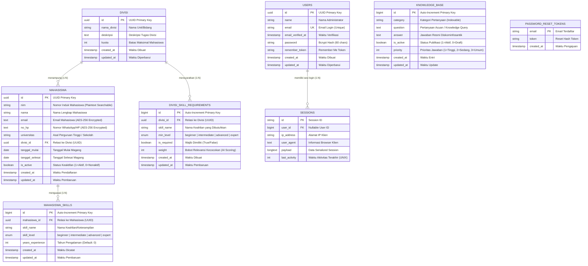

# DOKUMENTASI LENGKAP SKEMA DATABASE & ARSITEKTUR DATA
## SISTEM INFORMASI MANAJEMEN MAGANG (SIMAGANG)
**Dinas Komunikasi, Informatika, Persandian, dan Statistik (Diskominfosantik) Kabupaten Bekasi**

---

## 📌 Ringkasan Teknis Basis Data

| Parameter | Spesifikasi |
| :--- | :--- |
| **DBMS Engine** | MySQL 8.0+ / MariaDB 10.4+ |
| **Storage Engine** | InnoDB (Mendukung ACID Compliance & Foreign Key Constraints) |
| **Karakter Set / Collation** | `utf8mb4` / `utf8mb4_unicode_ci` (Dukungan Multibahasa & Emoji) |
| **Object-Relational Mapping (ORM)** | Laravel Eloquent (PHP 8.2+) |
| **Skema Primary Key Entitas Utama** | UUID Version 4 (`CHAR(36)`) untuk mencegah *ID enumeration attack* |
| **Skema Primary Key Sub-Entitas** | Auto-Increment `BIGINT UNSIGNED` untuk efisiensi indeks relasional |
| **Mekanisme Keamanan PII** | AES-256-CBC Payload Encryption + HMAC-SHA256 Integrity Verification |

---

## 🗺️ Entity Relationship Diagram (ERD)

Diagram berikut merepresentasikan seluruh entitas tabel basis data beserta kardinalitas relasi dan kunci penghubungnya:



---

## 📋 Kamus Data Spesifikasi Tabel (Data Dictionary)

Berikut adalah rincian struktur kolom, tipe data, atribut kunci, serta aturan validasi untuk setiap tabel dalam basis data SIMAGANG:

### 1. Tabel `users`
Menyimpan kredensial otentikasi administrator dan staf pengelola sistem SIMAGANG.

| Kolom | Tipe Data | Nullable | Default | Keterangan & Keamanan |
| :--- | :--- | :---: | :---: | :--- |
| `id` | `CHAR(36)` | NO | - | **Primary Key** (UUID v4) |
| `name` | `VARCHAR(255)` | NO | - | Nama lengkap pengelola/admin |
| `email` | `VARCHAR(255)` | NO | - | **Unique Key**, alamat email login resmi |
| `email_verified_at` | `TIMESTAMP` | YES | `NULL` | Timestamp verifikasi akun email |
| `password` | `VARCHAR(255)` | NO | - | Hash sandi menggunakan algoritma **Bcrypt** |
| `remember_token` | `VARCHAR(100)` | YES | `NULL` | Token sesi persistensi (*Remember Me*) |
| `created_at` | `TIMESTAMP` | YES | `NULL` | Waktu pembuatan data pengguna |
| `updated_at` | `TIMESTAMP` | YES | `NULL` | Waktu modifikasi terakhir data pengguna |

---

### 2. Tabel `divisi`
Menyimpan data unit kerja/bidang operasional magang di lingkungan Diskominfosantik beserta alokasi kapasitas kuota.

| Kolom | Tipe Data | Nullable | Default | Keterangan & Aturan Bisnis |
| :--- | :--- | :---: | :---: | :--- |
| `id` | `CHAR(36)` | NO | - | **Primary Key** (UUID v4) |
| `nama_divisi` | `VARCHAR(255)` | NO | - | Nama divisi (contoh: *Bidang IKP, Bidang Aptika, Bidang Statistik*) |
| `deskripsi` | `TEXT` | YES | `NULL` | Penjelasan rincian tugas dan fokus pekerjaan di divisi |
| `kuota` | `INT` | NO | `0` | Batas maksimum mahasiswa aktif yang dapat diterima |
| `created_at` | `TIMESTAMP` | YES | `NULL` | Waktu pembuatan data divisi |
| `updated_at` | `TIMESTAMP` | YES | `NULL` | Waktu pembaruan data divisi |

---

### 3. Tabel `mahasiswa`
Menyimpan data induk mahasiswa peserta program kerja praktik/magang. Kolom sensitif (*Personally Identifiable Information*) dienkripsi secara otomatis.

| Kolom | Tipe Data | Nullable | Default | Keterangan & Keamanan |
| :--- | :--- | :---: | :---: | :--- |
| `id` | `CHAR(36)` | NO | - | **Primary Key** (UUID v4) |
| `nim` | `VARCHAR(255)` | NO | - | Nomor Induk Mahasiswa/NISN (**Plaintext Indexable** untuk kemudahan pencarian cepat) |
| `nama` | `VARCHAR(255)` | NO | - | Nama lengkap peserta magang |
| `email` | `TEXT` | NO | - | **Encrypted (AES-256-CBC)**: Alamat email kontak mahasiswa |
| `no_hp` | `TEXT` | NO | - | **Encrypted (AES-256-CBC)**: Nomor kontak/WhatsApp mahasiswa |
| `universitas` | `VARCHAR(255)` | NO | - | Nama instansi pendidikan asal (Universitas / Institut / Politeknik / SMK) |
| `divisi_id` | `CHAR(36)` | NO | - | **Foreign Key** mereferensikan `divisi.id` (`ON DELETE CASCADE`) |
| `tanggal_mulai` | `DATE` | YES | `NULL` | Tanggal awal pelaksanaan kegiatan magang |
| `tanggal_selesai`| `DATE` | YES | `NULL` | Tanggal berakhir pelaksanaan kegiatan magang |
| `is_active` | `TINYINT(1)` | NO | `1` | Status keaktifan: `1` = Aktif (mengurangi kuota), `0` = Nonaktif/Selesai |
| `created_at` | `TIMESTAMP` | YES | `NULL` | Waktu registrasi mahasiswa ke dalam sistem |
| `updated_at` | `TIMESTAMP` | YES | `NULL` | Waktu pembaruan data mahasiswa |

---

### 4. Tabel `mahasiswa_skills`
Menyimpan profil kompetensi dan portofolio teknis yang dimiliki oleh masing-masing peserta magang.

| Kolom | Tipe Data | Nullable | Default | Keterangan & Constraint |
| :--- | :--- | :---: | :---: | :--- |
| `id` | `BIGINT UNSIGNED` | NO | Auto-Inc | **Primary Key** |
| `mahasiswa_id` | `CHAR(36)` | NO | - | **Foreign Key** mereferensikan `mahasiswa.id` (`ON DELETE CASCADE`) |
| `skill_name` | `VARCHAR(255)` | NO | - | Nama keahlian (contoh: *PHP, Laravel, UI/UX Design, Python*) |
| `skill_level` | `ENUM` | NO | - | Nilai: `'beginner'`, `'intermediate'`, `'advanced'`, `'expert'` |
| `years_experience`| `INT` | NO | `0` | Durasi pengalaman dalam tahun |
| `created_at` | `TIMESTAMP` | YES | `NULL` | Waktu pencatatan skill |
| `updated_at` | `TIMESTAMP` | YES | `NULL` | Waktu pembaruan skill |

---

### 5. Tabel `divisi_skill_requirements`
Menyimpan kriteria teknis yang dipersyaratkan oleh masing-masing unit/divisi untuk pencocokan kompetensi pelamar.

| Kolom | Tipe Data | Nullable | Default | Keterangan & Constraint |
| :--- | :--- | :---: | :---: | :--- |
| `id` | `BIGINT UNSIGNED` | NO | Auto-Inc | **Primary Key** |
| `divisi_id` | `CHAR(36)` | NO | - | **Foreign Key** mereferensikan `divisi.id` (`ON DELETE CASCADE`) |
| `skill_name` | `VARCHAR(255)` | NO | - | Keahlian yang dicari divisi |
| `min_level` | `ENUM` | NO | - | Tingkat kompetensi minimum yang diharapkan |
| `is_required` | `TINYINT(1)` | NO | `0` | Flag wajib (`1` = Syarat mutlak, `0` = Nilai tambah) |
| `weight` | `INT` | NO | `1` | Bobot skor kesesuaian pelamar |
| `created_at` | `TIMESTAMP` | YES | `NULL` | Waktu penetapan syarat divisi |
| `updated_at` | `TIMESTAMP` | YES | `NULL` | Waktu pembaruan syarat divisi |

---

### 6. Tabel `knowledge_base`
Basis data pengetahuan resmi (*Knowledge Repository*) yang digunakan oleh mesin AI Chatbot NLP berbasis *Dice's Similarity Coefficient*.

| Kolom | Tipe Data | Nullable | Default | Keterangan & Indeks |
| :--- | :--- | :---: | :---: | :--- |
| `id` | `BIGINT UNSIGNED` | NO | Auto-Inc | **Primary Key** |
| `category` | `VARCHAR(255)` | YES | `NULL` | Kategori topik (**Indexed**: *Syarat, Alur, Jadwal, Divisi, Fasilitas, dll.*) |
| `question` | `TEXT` | NO | - | Kalimat pertanyaan baku/variasi pertanyaan pemohon |
| `answer` | `TEXT` | NO | - | Format jawaban resmi (*HTML supported* untuk teks tebal/poin) |
| `is_active` | `TINYINT(1)` | NO | `1` | **Indexed**: Status aktivasi basis pengetahuan (`1` = Aktif dicari, `0` = Draft) |
| `priority` | `INT` | NO | `0` | **Indexed**: Bobot prioritas pencocokan (`1`=Tinggi, `2`=Sedang, `3`=Umum) |
| `created_at` | `TIMESTAMP` | YES | `NULL` | Waktu entri pengetahuan |
| `updated_at` | `TIMESTAMP` | YES | `NULL` | Waktu pembaruan pengetahuan |

---

### 7. Tabel Pendukung Sesi & Keamanan

#### A. Tabel `sessions`
| Kolom | Tipe Data | Nullable | Default | Keterangan |
| :--- | :--- | :---: | :---: | :--- |
| `id` | `VARCHAR(255)` | NO | - | **Primary Key** Session Hash Token |
| `user_id` | `BIGINT UNSIGNED` | YES | `NULL` | **Indexed** ID Admin yang sedang login |
| `ip_address` | `VARCHAR(45)` | YES | `NULL` | Alamat IPv4/IPv6 pengguna |
| `user_agent` | `TEXT` | YES | `NULL` | Tipe peramban/perangkat klien |
| `payload` | `LONGTEXT` | NO | - | Data serialisasi sesi terenkripsi |
| `last_activity` | `INT` | NO | - | **Indexed** Timestamp UNIX aktivitas terakhir |

#### B. Tabel `password_reset_tokens`
| Kolom | Tipe Data | Nullable | Default | Keterangan |
| :--- | :--- | :---: | :---: | :--- |
| `email` | `VARCHAR(255)` | NO | - | **Primary Key** Email akun yang meminta reset sandi |
| `token` | `VARCHAR(255)` | NO | - | Token verifikasi reset sandi |
| `created_at` | `TIMESTAMP` | YES | `NULL` | Waktu pengajuan token |

---

## 🔒 Arsitektur Keamanan Data & Enkripsi (PII Protection)

Sistem SIMAGANG mengimplementasikan prinsip perlindungan data pribadi (*Data Privacy by Design*):

1. **Atribut Terenkripsi (Encrypted Attributes)**:
   - Field `mahasiswa.email` dan `mahasiswa.no_hp` disimpan dalam bentuk ciphertext terenkripsi di database menggunakan cipher **AES-256-CBC**.
   - Setiap nilai enkripsi dilengkapi dengan Message Authentication Code (**HMAC-SHA256**) untuk mencegah serangan manipulasi *ciphertext tampering*.
2. **Atribut Plaintext Terindeks**:
   - Field `mahasiswa.nim` disimpan dalam format teks polos (*plaintext*) agar proses pencarian cepat (*instant live search & filtering*) di halaman admin maupun pencetakan laporan PDF/Excel berjalan dengan kompleksitas waktu optimal $\mathcal{O}(1)$ tanpa harus mendekripsi seluruh baris database di memory.
3. **Password Hashing**:
   - Password administrator disimpan dengan hashing satu arah **Bcrypt (Blowfish)** menggunakan *salt* acak dinamis 10-12 *work factor rounds*.

---

## ⚡ Strategi Pengindeksan & Optimasi Performa (Indexing Strategy)

Untuk memastikan respons kueri chatbot sub-10 milidetik dan efisiensi laporan:

| Nama Indeks | Tabel | Kolom Target | Tipe Indeks | Tujuan Optimasi |
| :--- | :--- | :--- | :---: | :--- |
| `PRIMARY` | `users` | `id` | B-Tree Clustered | Pencarian instan akun administrator |
| `users_email_unique` | `users` | `email` | Unique B-Tree | Menjamin integritas unik alamat email |
| `PRIMARY` | `divisi` | `id` | B-Tree Clustered | Relasi cepat ke data mahasiswa |
| `PRIMARY` | `mahasiswa` | `id` | B-Tree Clustered | Akses langsung ke entitas mahasiswa |
| `mahasiswa_divisi_id_foreign` | `mahasiswa` | `divisi_id` | Non-Clustered | Join cepat saat rekapitulasi kuota divisi |
| `knowledge_base_category_index` | `knowledge_base` | `category` | Non-Clustered | Filter kategori basis pengetahuan |
| `knowledge_base_is_active_index` | `knowledge_base` | `is_active` | Non-Clustered | Seleksi hanya data aktif oleh mesin NLP |
| `knowledge_base_priority_index` | `knowledge_base` | `priority` | Non-Clustered | Pengurutan prioritas pencocokan chatbot |

---

## 🛠️ Script DDL (Data Definition Language) SQL Siap Pakai

Berikut adalah script SQL DDL murni yang dapat dieksekusi secara langsung pada *database client* (seperti phpMyAdmin, DBeaver, Navicat, MySQL Workbench):

```sql
-- =================================================================
-- SKEMA BASIS DATA SIMAGANG (DISKOMINFOSANTIK KABUPATEN BEKASI)
-- DBMS: MySQL 8.0+ / MariaDB 10.4+
-- =================================================================

SET FOREIGN_KEY_CHECKS = 0;
DROP TABLE IF EXISTS `divisi_skill_requirements`;
DROP TABLE IF EXISTS `mahasiswa_skills`;
DROP TABLE IF EXISTS `mahasiswa`;
DROP TABLE IF EXISTS `divisi`;
DROP TABLE IF EXISTS `knowledge_base`;
DROP TABLE IF EXISTS `sessions`;
DROP TABLE IF EXISTS `password_reset_tokens`;
DROP TABLE IF EXISTS `users`;
SET FOREIGN_KEY_CHECKS = 1;

-- 1. TABEL USERS (ADMINISTRATOR)
CREATE TABLE `users` (
  `id` CHAR(36) NOT NULL,
  `name` VARCHAR(255) NOT NULL,
  `email` VARCHAR(255) NOT NULL,
  `email_verified_at` TIMESTAMP NULL DEFAULT NULL,
  `password` VARCHAR(255) NOT NULL,
  `remember_token` VARCHAR(100) NULL DEFAULT NULL,
  `created_at` TIMESTAMP NULL DEFAULT NULL,
  `updated_at` TIMESTAMP NULL DEFAULT NULL,
  PRIMARY KEY (`id`),
  UNIQUE KEY `users_email_unique` (`email`)
) ENGINE=InnoDB DEFAULT CHARSET=utf8mb4 COLLATE=utf8mb4_unicode_ci;

-- 2. TABEL DIVISI (UNIT KERJA MAGANG)
CREATE TABLE `divisi` (
  `id` CHAR(36) NOT NULL,
  `nama_divisi` VARCHAR(255) NOT NULL,
  `deskripsi` TEXT NULL DEFAULT NULL,
  `kuota` INT NOT NULL DEFAULT 0,
  `created_at` TIMESTAMP NULL DEFAULT NULL,
  `updated_at` TIMESTAMP NULL DEFAULT NULL,
  PRIMARY KEY (`id`)
) ENGINE=InnoDB DEFAULT CHARSET=utf8mb4 COLLATE=utf8mb4_unicode_ci;

-- 3. TABEL MAHASISWA (PESERTA MAGANG)
CREATE TABLE `mahasiswa` (
  `id` CHAR(36) NOT NULL,
  `nim` VARCHAR(255) NOT NULL,
  `nama` VARCHAR(255) NOT NULL,
  `email` TEXT NOT NULL,
  `no_hp` TEXT NOT NULL,
  `universitas` VARCHAR(255) NOT NULL,
  `divisi_id` CHAR(36) NOT NULL,
  `tanggal_mulai` DATE NULL DEFAULT NULL,
  `tanggal_selesai` DATE NULL DEFAULT NULL,
  `is_active` TINYINT(1) NOT NULL DEFAULT 1,
  `created_at` TIMESTAMP NULL DEFAULT NULL,
  `updated_at` TIMESTAMP NULL DEFAULT NULL,
  PRIMARY KEY (`id`),
  KEY `mahasiswa_divisi_id_foreign` (`divisi_id`),
  CONSTRAINT `mahasiswa_divisi_id_foreign` FOREIGN KEY (`divisi_id`) REFERENCES `divisi` (`id`) ON DELETE CASCADE
) ENGINE=InnoDB DEFAULT CHARSET=utf8mb4 COLLATE=utf8mb4_unicode_ci;

-- 4. TABEL MAHASISWA_SKILLS (KOMPETENSI MAHASISWA)
CREATE TABLE `mahasiswa_skills` (
  `id` BIGINT UNSIGNED NOT NULL AUTO_INCREMENT,
  `mahasiswa_id` CHAR(36) NOT NULL,
  `skill_name` VARCHAR(255) NOT NULL,
  `skill_level` ENUM('beginner', 'intermediate', 'advanced', 'expert') NOT NULL,
  `years_experience` INT NOT NULL DEFAULT 0,
  `created_at` TIMESTAMP NULL DEFAULT NULL,
  `updated_at` TIMESTAMP NULL DEFAULT NULL,
  PRIMARY KEY (`id`),
  KEY `mahasiswa_skills_mahasiswa_id_foreign` (`mahasiswa_id`),
  CONSTRAINT `mahasiswa_skills_mahasiswa_id_foreign` FOREIGN KEY (`mahasiswa_id`) REFERENCES `mahasiswa` (`id`) ON DELETE CASCADE
) ENGINE=InnoDB DEFAULT CHARSET=utf8mb4 COLLATE=utf8mb4_unicode_ci;

-- 5. TABEL DIVISI_SKILL_REQUIREMENTS (PERSYARATAN DIVISI)
CREATE TABLE `divisi_skill_requirements` (
  `id` BIGINT UNSIGNED NOT NULL AUTO_INCREMENT,
  `divisi_id` CHAR(36) NOT NULL,
  `skill_name` VARCHAR(255) NOT NULL,
  `min_level` ENUM('beginner', 'intermediate', 'advanced', 'expert') NOT NULL,
  `is_required` TINYINT(1) NOT NULL DEFAULT 0,
  `weight` INT NOT NULL DEFAULT 1,
  `created_at` TIMESTAMP NULL DEFAULT NULL,
  `updated_at` TIMESTAMP NULL DEFAULT NULL,
  PRIMARY KEY (`id`),
  KEY `divisi_skill_requirements_divisi_id_foreign` (`divisi_id`),
  CONSTRAINT `divisi_skill_requirements_divisi_id_foreign` FOREIGN KEY (`divisi_id`) REFERENCES `divisi` (`id`) ON DELETE CASCADE
) ENGINE=InnoDB DEFAULT CHARSET=utf8mb4 COLLATE=utf8mb4_unicode_ci;

-- 6. TABEL KNOWLEDGE_BASE (DATA PENGETAHUAN CHATBOT NLP)
CREATE TABLE `knowledge_base` (
  `id` BIGINT UNSIGNED NOT NULL AUTO_INCREMENT,
  `category` VARCHAR(255) NULL DEFAULT NULL,
  `question` TEXT NOT NULL,
  `answer` TEXT NOT NULL,
  `is_active` TINYINT(1) NOT NULL DEFAULT 1,
  `priority` INT NOT NULL DEFAULT 0,
  `created_at` TIMESTAMP NULL DEFAULT NULL,
  `updated_at` TIMESTAMP NULL DEFAULT NULL,
  PRIMARY KEY (`id`),
  KEY `knowledge_base_category_index` (`category`),
  KEY `knowledge_base_is_active_index` (`is_active`),
  KEY `knowledge_base_priority_index` (`priority`)
) ENGINE=InnoDB DEFAULT CHARSET=utf8mb4 COLLATE=utf8mb4_unicode_ci;

-- 7. TABEL SESSIONS (SESI OTENTIKASI)
CREATE TABLE `sessions` (
  `id` VARCHAR(255) NOT NULL,
  `user_id` BIGINT UNSIGNED NULL DEFAULT NULL,
  `ip_address` VARCHAR(45) NULL DEFAULT NULL,
  `user_agent` TEXT NULL DEFAULT NULL,
  `payload` LONGTEXT NOT NULL,
  `last_activity` INT NOT NULL,
  PRIMARY KEY (`id`),
  KEY `sessions_user_id_index` (`user_id`),
  KEY `sessions_last_activity_index` (`last_activity`)
) ENGINE=InnoDB DEFAULT CHARSET=utf8mb4 COLLATE=utf8mb4_unicode_ci;

-- 8. TABEL PASSWORD_RESET_TOKENS
CREATE TABLE `password_reset_tokens` (
  `email` VARCHAR(255) NOT NULL,
  `token` VARCHAR(255) NOT NULL,
  `created_at` TIMESTAMP NULL DEFAULT NULL,
  PRIMARY KEY (`email`)
) ENGINE=InnoDB DEFAULT CHARSET=utf8mb4 COLLATE=utf8mb4_unicode_ci;
```
